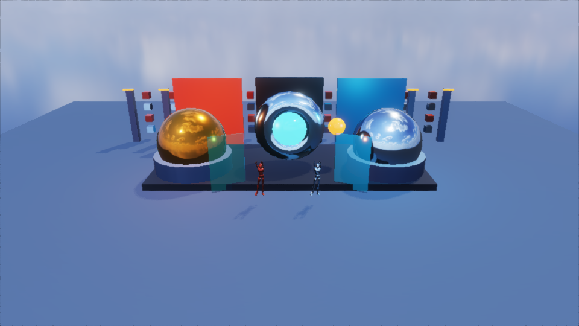
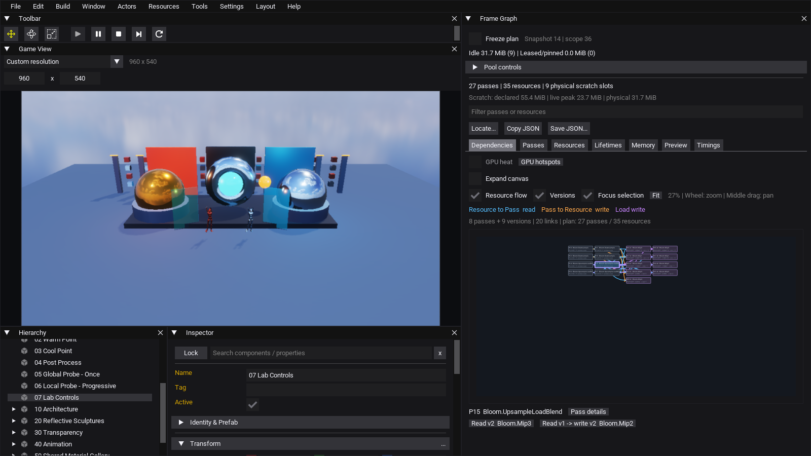
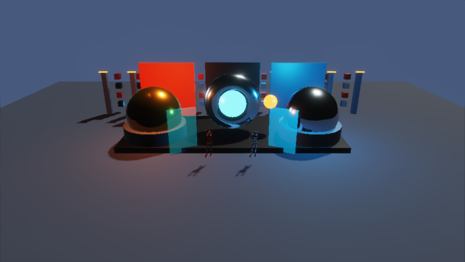

# Frame Graph 实验室

这是可以在真实 Editor 中运行、开关效果并检查依赖的验收场景。100 个 Actor、12 个材质，
模型直接引用引擎的 Cube、Cylinder、Sphere、Torus、Mannequin，复用当前渲染实现。

## 启动

主线 Debug/Release 原生库和 OvEditor 对象编译完成后，双击同目录的 `Open Editor.cmd`。
需要本机已有的 Node.js、VS2022 C++ 工具和 Windows SDK。命令行也可以运行：

~~~powershell
node Examples/FrameGraphLab/run.mjs
~~~

入口自动加载 `Assets/Scenes/FrameGraphLab.ovscene`、开始 Play，左侧 Game View / Hierarchy /
Inspector，右侧 Frame Graph。使用生产 Editor、面板、Lua 和帧提交路径。

默认单 Game View，960 × 540 渲染；场景视图可从 Window 菜单打开，此时图会增加该视图的链。
窗口初始布局为 1600 × 900，面板可手动移动、缩放。

也可用普通 OvEditor 打开 `FrameGraphLab.ovproject`，在 Asset Browser 中打开该场景，
从 Window 菜单打开 Frame Graph，再按 Play。普通入口使用你自己的布局。

专用入口的资源目录指向仓库 Resources，编辑器偏好隔离在 `Build/FrameGraphLab/<配置>/Profile`，
不会覆盖日常编辑器布局。启动脚本编译少量宿主代码，产物放在 Build，不复制模型或另建项目副本。

## 场景中的行为

- `01 Shadow Sun`：1024² 方向光阴影，地面、立柱、雕塑和骨骼角色参与。
- `02/03`：暖色、冷色点光源，便于辨认明暗与材质。
- `05 Global Probe - Once`：初始化捕获完整六面，之后保留历史内容。
- `06 Local Probe - Progressive`：实时局部探针，默认每帧一面，完整一轮后生成 mip。
- `08 HDRI Skysphere`：天空参与主视图和 cubemap 捕获，让金属表面能反射云层。
- `20 Reflective Sculptures`：金属球、环、轨道发光球；移动改变阴影和局部反射。
- `30 Transparency`：两块透明面板，观察混合与不透明物体遮挡。
- `40 Animation`：两个骨骼角色，参与主视图、阴影和反射捕获。
- `50 Shared Material Gallery`：48 个共用材质的小方块，供后续提取/准备成本优化复测。
- `04 Post Process`：自动曝光历史、五级 Bloom 下采样/上采样、ACES、Gamma、FXAA。

反射是 cubemap 探针；透明面板采用 alpha 混合。目前没有新增屏幕空间反射、光线追踪、
真实折射、级联阴影或点光源阴影。这是有多种真实行为的前向渲染场景。

场景基线使用较粗糙的介电地面，金属球和环使用更易读的粗糙度，探针移离雕塑中心。
大网格或跨越局部探针边界的网格现在使用全局探针，避免探针盒外出现环境光缺口；
完整位于局部盒内的网格仍使用最近的局部探针。当前没有逐像素探针混合，移动越界时可能切换环境。

天空图由引擎自带的 `PureSky.hdr` 在线性 HDR 空间平均缩小到 1024×512，保留亮度范围；
本例使用生成的 `Assets/Textures/LabSky.hdr`，RGBA32F 基础级约 8 MiB、不启用 mip。
原始 4096×2048 天空若直接加载约需 128 MiB，本例不加载它，也不增加阴影图或 cubemap 尺寸。
天空是在 MainView 和 ReflectionCapture 中绘制的网格，图里不会增加独立的 Sky Pass。

关闭天空后的原生对照图：

## 操作开关

**先点击 Game View 的画面，再按快捷键。** 专用入口在 Game View 失去焦点或编辑文本时
暂停快捷键响应，方便使用 Frame Graph 的搜索和定位。
选择 `07 Lab Controls`，在 Inspector 中展开脚本，也可以修改同名布尔字段。

| 按键 | 对应字段 | 画面与图中的观察点 |
|---|---|---|
| `1` | shadows | 地面投影改变；`Shadows` Pass 消失/恢复 |
| `2` | reflections | 金属表面环境反射改变；捕获与反射 mip Pass 消失/恢复 |
| `3` | bloom | 光晕改变；全部 `Bloom.*` Pass 消失/恢复 |
| `4` | exposure | 曝光校正改变；全部 `Exposure.*` Pass 消失/恢复 |
| `5` | fxaa | 边缘变化较细；`FXAA` Pass 消失/恢复 |
| `6` | progressiveCapture | 局部探针每帧一面/六面切换，稳定捕获 Pass 数为 1/6 |
| `7` | environment | 天空显示/隐藏并请求两个探针完整重捕获；金属云层反射改变 |
| `T` | glass | 两块透明面板出现/隐藏，主视图 Pass 仍然存在 |
| `G` | gallery | 小方块出现/隐藏，主视图 Pass 仍然存在 |
| `P` | animate | 暂停/恢复环、轨道球及两个骨骼角色 |
| `R` | — | 请求两个探针完整重新捕获；短暂出现 12 个捕获 Pass |

Play 中的修改是临时状态；Stop 恢复场景。`P` 暂停物体运动，曝光和反射更新仍运行。
工具栏 Pause 暂停整个游戏逻辑，Frame Graph 的 Freeze plan 只冻结诊断快照。

## 建议按这个顺序人工验收

1. 运行后观察移动阴影、光晕与金属表面；点击 Game View，按 `P` 暂停运动。
   在 Inspector 将 `exposureProgressive` 关闭，方便稳定比较画面；默认渐进曝光用于观察历史更新。
2. 右侧 **Dependencies → Locate...** 搜索 `MainView` 或 `Shadows`，选择目标。
   保持 Resource flow、Versions，查看读资源 → Pass → 写资源/版本。
   滚轮放大、中键拖动；取消 Focus selection 看全图，Fit 重新适配。
   多节点的全图字号较小，可启用 Expand canvas 展开，再定位局部链。
3. 按 `1`，对照地面与 `Shadows` 分支。Once 探针保存的反射可能仍有旧阴影，
   按 `R` 后再观察，这是探针历史语义。定位阴影深度资源，到 **Preview** 捕获，检查 depth 通道。
4. 按 `6` 比较 `ReflectionCapture` 的 1/6 个 Pass；观察相应 cubemap 的 layer/面范围。
   每帧一面时 `Reflection.Mipmaps` 只在一轮完成时出现。按 `R` 后立即 Freeze plan，
   可人工保留完整六面捕获计划；实时捕获太短时可直接看自动验收的 `cold.json`/`recapture.json`。
   按 `7` 隐藏天空，等待捕获完成后比较金属表面；再按 `7` 恢复。按 `2` 仅关闭反射时，
   背景天空仍在，金属球失去环境反射。两组对照帮助区分背景绘制和探针采样。
5. 定位 `Bloom.Downsample`，查看五级 mip 的读写版本；定位 `Bloom.UpsampleLoadBlend`，
   查看 Load 保留的旧内容和写入的新版本。按 `3`，光晕与整段 Bloom 链一起变化。
6. 定位 `Exposure.Adaptation`，在 Resources 中检查 `ExposurePingPong*` 的 History 来源。
   按 `4/5` 分别观察曝光链、FXAA 链；不要把物体消失和 Pass 消失混为一谈。
7. 到 **Lifetimes** 比较逻辑资源与物理槽、非重叠区间和内存峰值；到 **Memory** 查看实时池分类。
   将 Game View 自定义分辨率改为 640 × 360，再恢复 960 × 540，旧尺寸资源应进入 unused，
   可以观察自动回收，或展开 Pool controls 使用 Trim idle。
8. 到 **Timings** 开启 GPU 采样，等待有匹配计划的结果，再看热点/GPU heat。
   计时是本机观察值，默认未开启；导出 JSON 保存完整计划，筛选只影响面板显示。

Probe 初始化、曝光历史初始化、六面完成生成 mip 等行为，会让相邻帧的 Pass 数不同。
当前主线实测首次捕获 **41 Pass / 36 资源**，稳定逐面更新 **27–28 Pass / 34–35 资源**，
每帧六面更新 **33 Pass**；这不是固定的每帧承诺。
Frame Graph 继续保持产品既定执行顺序；本例没有加入自动 Pass 裁剪或重排。

## 自动验收与复现

~~~powershell
node Tests/RenderingCommands/run-framegraph-lab.mjs Release
node Tests/RenderingCommands/run-framegraph-lab.mjs Debug
~~~

依次运行 Main/Render consumer 的真实 Editor，使用固定 dt、暂停初始运动和非渐进曝光，
经 Window 输入事件触发全部快捷键，验证脚本状态、Pass、History、资源版本和物理池。
继续运行骨骼/轨道运动、暂停、分辨率缩小/恢复，分别捕获图与画面。
同配置两种 consumer 的 **16 张场景图逐字节相同**，不使用像素容差；资源与项目设置保持原样。
额外验证局部探针包含/边界/旋转/全局回退，并在 GL owner 上确认天空纹理实际为
1024×512 RGBA32F、无 mip、HDR 数值大于 1；证据为每个输出目录的 `environment-info.json`。
相交雕塑使用明确的材质绘制优先级，使等深度边缘也能作为可重复的基线。

结果：`Build/FrameGraphLabValidation/<配置>-result.json`。
原始 RGBA、尺寸、完整 JSON 和原生编辑器画面：`Build/FrameGraphLabValidation/<配置>-<main|render>/`。
较大产物不进入 Git；预览 PNG 来自原生渲染读回。
场景可用 `node Examples/FrameGraphLab/generate.mjs` 重新生成；它只写本例的场景/材质/清单，
修改生成后的场景之前请注意保留自己的版本。
