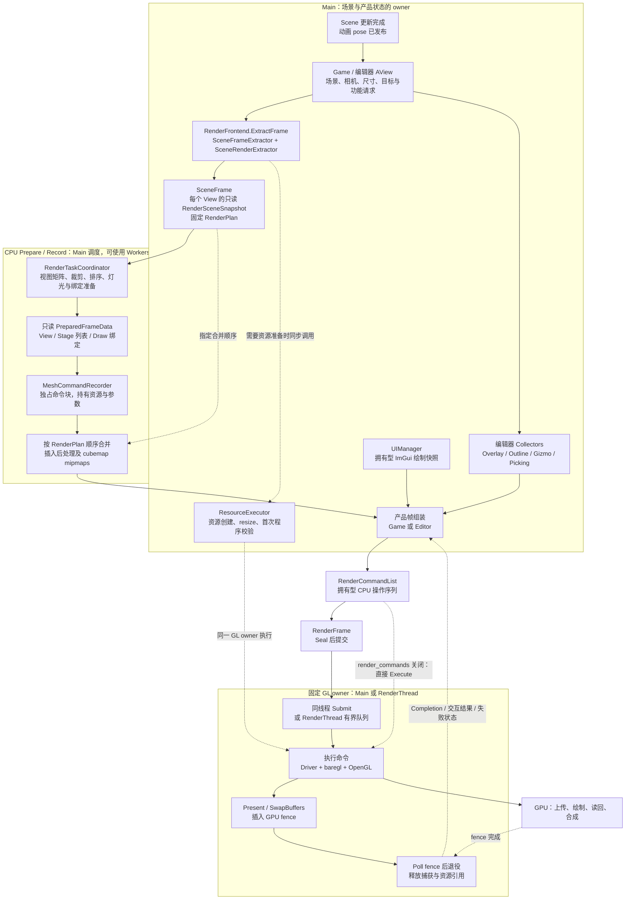
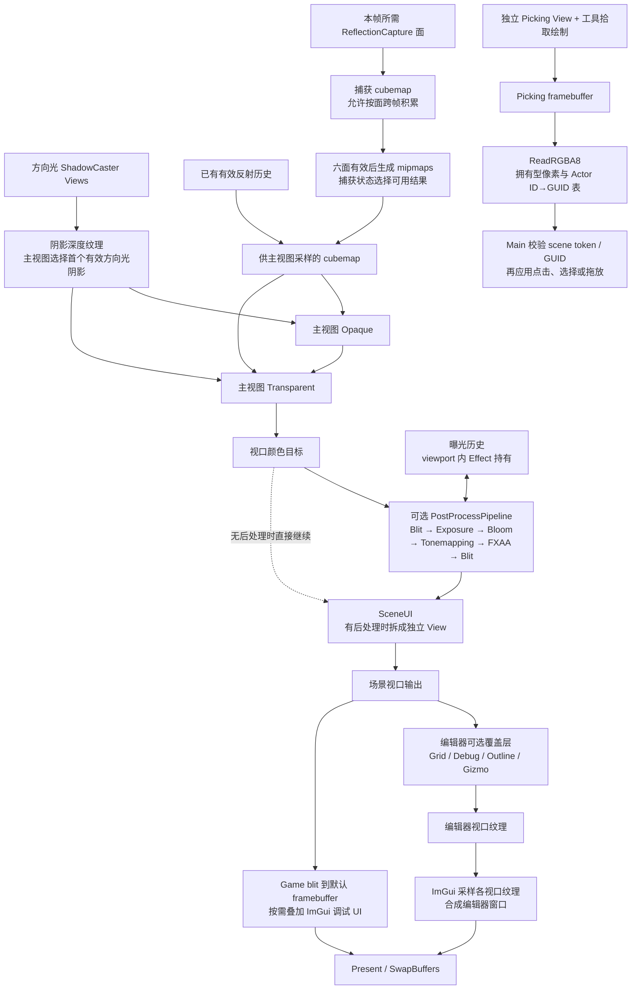
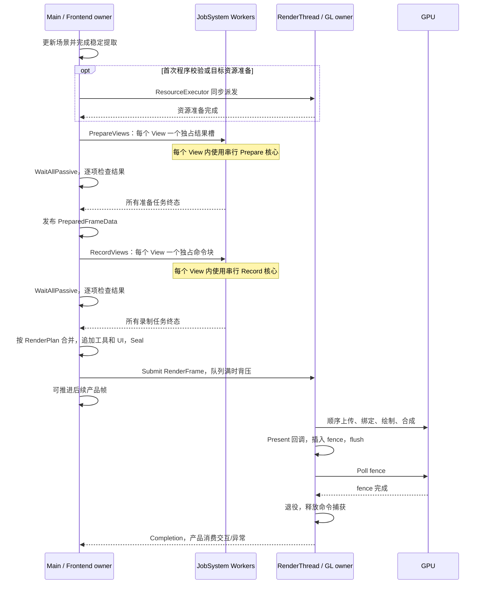
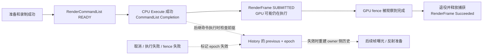

# 当前渲染架构、数据流与组织评估

核对日期：2026-09-11。代码基线：`b8095db4417fd8ba864723b190b8a4b5a377e310`。

本文依据当前产品调用链和实现绘制。实线表示数据传递或执行顺序，虚线表示调度、校验或状态反馈；条件功能只在启用时出现。本文只新增说明文档，没有修改引擎代码，也没有重新运行构建、图像回归或性能测试。

总体判断：**目前的分层适合单 OpenGL 执行 owner 的引擎，快照、任务输出和 GPU 资源生命周期边界比较清楚。下一步应优先补全资源计划的覆盖范围、减少提取层的重复工作，再考虑更细的并行调度与多后端抽象。**

## 1. 全局架构与数据流

这里有两个不同的“帧”：

| 类型 | 实际范围 | 输入与输出 |
| --- | --- | --- |
| `SceneFrame` | 一个产品视口的场景渲染，含主视图及本次需要的阴影、反射、SceneUI 视图 | 拥有只读 View 快照、`RenderPlan`、准备结果和历史登记；`RecordFrame` 消费它并返回命令列表 |
| `RenderFrame` | 一次产品提交，可包含多个编辑器视口、工具绘制和最终 ImGui | 接收命令列表，管理提交、呈现回调、GPU fence、成功/失败和退役 |

`RenderFrontend` 是统一入口**类型**，并非全局单例：`AView` 各自持有 frontend、目标表面和后处理实例，Picking 也复用该入口。frontend 的公开方法要求在构造它的线程上调用；内部协调器才把纯数据工作交给 Worker。

### 数据在每一层如何变化

| 阶段 | 输入 | 产出 / 所有权 | 允许访问的状态 |
| --- | --- | --- | --- |
| Extract | `SceneRenderRequest` / `SceneFrameRequest`，含 Scene、Camera、Material 等 owner 侧引用 | `shared_ptr<const RenderSceneSnapshot>`；复制矩阵、灯光、骨骼 palette、材质值，保留几何/程序/纹理代际 | Main 稳定读取期可访问 ECS；资源准备可同步派发到 GL owner |
| Plan | 阴影、反射、主视图与目标需求 | `RenderPlan` 的 Pass 顺序、附件及资源 reads/writes | owner 声明 Imported / History 内容是否可用；`Validate` 检查已声明的契约 |
| Prepare | 只读 View 快照和基础 `PipelineState` | 发布只读 `PreparedFrameData`，含裁剪与排序后的 Draw、Stage 范围和绑定 | 不回查 Scene / Actor / 源 Material；任务先写独占槽，汇合成功后发布 |
| Record | 只读准备结果、目标快照 | `RenderCommandList`；命令闭包持有几何、材质、palette、目标等 | CPU 侧捕获参数；实际 Buffer 上传、绑定、Draw 留到 Execute |
| Execute | READY 命令列表或 `RenderFrame` | GL 命令、目标纹理、读回像素、呈现请求、完成状态 | 同一个 GL owner 顺序执行；`Driver` 和 baregl 都参与后端操作 |
| Retire | GPU fence 结果 | 帧完成 token、捕获释放；失败时历史失效 | 产品在 Main 消费结果；GL 删除由正确 owner 处理 |

资源快照保留的是**资源代际与生命周期**。它不会自动把一个动态纹理或 Buffer 的每次内容都复制一份；动态内容正确性仍依赖命令顺序和资源生产/消费契约。

## 2. 一帧内的 GPU 资源流向

下图表示现有功能的逻辑资源关系；`RenderPlan` 当前只覆盖其中一部分。主视图是前向 Opaque/Transparent 渲染，没有在此链路中发现独立 G-buffer 阶段。

- `SceneFrameExtractor` 按 **Shadows → 本帧反射捕获 → MainView → 可选 SceneUI** 建立固定顺序。CPU 任务可以乱序完成，命令按这个顺序追加。
- 反射捕获使用独立相机和 cubemap face。捕获 View 本身不接收主视图的阴影/反射绑定；它们的 CPU 准备因此不必等待主视图准备。
- 启用后处理时，主视图先输出到视口目标，`PostProcessPipeline` 在私有 ping-pong 目标之间运行，再写回原目标；SceneUI 随后叠加，避免被这条后处理链处理。各 Effect 仅在适用时执行。
- Picking 输出是独立像素结果，不参与最终屏幕合成。读回命令在 GL owner 执行；应用交互时检查场景生命周期和 Actor GUID，避免旧帧误作用于删除或替换后的对象。
- 编辑器先完成各视口输出，最终 ImGui 才采样这些纹理。`SceneUI` 与 ImGui 是两条不同的数据路径。

## 3. CPU 并发与线程时序

这不是“所有阶段任意并行”的任务图，当前有明确的批次汇合边界：

| 调用路径 | 实际并行粒度 | 汇合点与限制 |
| --- | --- | --- |
| `Prepare(scene, jobs)` / `Record(frame, jobs)` | 单 View 的候选范围、绑定范围、绘制范围分块 | 候选完成后做全局 Stage 排序，再准备绑定；固定槽位合并命令 |
| `PrepareFrame` / `RecordFrame` | `PrepareViews` / `RecordViews` 按 View 派发 | View 内传 `jobs=nullptr` 调用相同串行核心，避免 Worker 嵌套调度等待；准备批次全部结束后才启动录制批次 |
| 编辑器 Asset / Game / Scene 三视口 | 产品目前依次调用三个 `RecordRenderCommands` | 每次调用内部已经完成场景 Prepare/Record；没有一次性发出三个产品视口的全部场景任务 |
| 产品 `RenderFrame::Seal(jobs)` | 汇总后的 deferred operation factories 可分块编码 | 仅在满足 Worker 数与数量阈值时并行；当前要求至少 2 个 Worker、至少 128 个 deferred 项。不会把已完成的 Mesh 录制重新变成跨视口并行 |
| RenderThread | CPU 产品生产可与 GL 消费重叠 | GL 调用仍由同一个 owner 串行提交，GPU 内部并行交由驱动/硬件 |

透明物体必须先合并完整候选集合，再稳定排序。任务完成顺序不能替代绘制顺序。`WaitAllPassive` 只等终态，因此协调器还检查 exception、成功标记和输出是否存在；异常/取消/部分 Submit 失败时也先汇合已提交任务。

产品设置缺省值：`render_commands=true`，`render_thread=false`，`parallel_recording=false`；实际项目文件可覆盖。`render_thread=true` 要求启用 `render_commands`。同线程帧提交后，当前产品调用 `Wait()`；关闭帧提交则直接执行同一条显式命令路径。

## 4. 完成、历史与生命周期

需要区分三个事实：

1. **任务终态不等于准备成功。** JobSystem 允许失败或未执行的任务进入终态，业务层必须检查结果。
2. **命令列表完成不等于 GPU 完成。** `RenderCommandList::Completion` 表示 CPU 命令消费成功；`RenderFrame::Completion::Succeeded()` 还要求 fence 已完成并退役。呈现回调返回也不等于图像已经在物理显示器上可见。
3. **历史可排序使用不等于必须逐帧等 GPU。** 当前 `RenderCommandList::History` 用前驱状态和共享 epoch 验证消费顺序；同一 GL 队列的顺序使后继可以提交。帧随后失败会使历史失效，RenderThread 还会保守地使在途后继失败，避免发布成功结果。不能画成“录制完成就提交历史”，也不能画成“每次复用历史都必须 Main 等 fence”。

### 关键状态归属

| 状态 | 当前 owner | 消费/保护方式 |
| --- | --- | --- |
| Scene / Actor / Camera / 源 Material、single-use 属性 | Main 的场景与产品对象 | Extract 读取/消费；Worker 只收到拥有型快照 |
| View 矩阵、候选、Draw 绑定 | 准备任务的独占结果槽 | 汇合成功后发布只读结果 |
| Framebuffer 尺寸与后处理 ping-pong 状态 | 每个 `AView` 或 Game 的 viewport owner | target/storage snapshot 保留在途代际；资源变更派发给 GL owner |
| 曝光历史 | viewport 的 `PostProcessPipeline` 内 Effect | 命令登记 History；失败 epoch 触发重建 |
| 反射捕获游标、完整性与缓冲 | `CReflectionProbe` | Main 提取期推进；`m_captureHistory` 跟踪投机状态的失败 |
| GPU UBO / SSBO 和实际绑定状态 | GL owner | Worker 仅捕获所需上传内容；按操作序列上传和 Draw |
| Picking 像素、场景 token 和 GUID 表 | 拥有型 `PickingReadback` | GL 填充像素，Main 在完成后验证并解析 |
| 提交队列、GPU fence、最终资源删除 | RenderThread，或同线程 GL owner | 有界入队、顺序 Poll/退役、DeletionQueue、停机 drain/join |

## 5. 当前组织是否合理

### 已经做得合理的部分

- **业务状态与渲染消费分开。** `OvCore::Rendering` 负责 ECS 适配，`OvRendering` 的准备/录制消费纯值及保留资源；修改或销毁源对象不会要求 Worker 回查它们。
- **并发协议集中。** `RenderTaskCoordinator` 统一处理任务提交、独占输出、固定顺序汇合和失败传播。多视图 Worker 内复用串行核心，避开两层调度互等。
- **资源生命期和内容依赖分开处理。** snapshot/retained geometry 保证对象活着；RenderPlan、操作追加顺序和 History 处理内容可用性。
- **产品交互有结果校验。** Picking 使用场景 token 和 GUID 验证；工具与 ImGui 都能进入拥有型命令与产品帧，不需要 Worker 访问面板。

### 建议按以下顺序改进

| 顺序 | 已确认的现状与代码依据 | 影响与建议 |
| --- | --- | --- |
| 1：补齐计划可见性（已完成） | MainView/SceneUI/CanvasUI/OverlayUI 已把可写颜色附件登记为 `writes`；后处理有显式 `postProcessReads/Writes`；AView 声明 Overlay/Picking 为 `trailing` 合成 | `RenderPlan::Validate` 覆盖整帧资源契约（含 trailing）。仍不是自动调度的 Render Graph；深度/stencil renderbuffer 仍归 framebuffer owner |
| 2：减少提取重复工作（已完成） | 帧内 `meshBases` 一次捕获 transform/geometry/palette/bounds；各 View 只做可见性与材质/阶段选择。palette 跨 mesh/View 共享；无 single-use 时跳过有序 resolve | 保持 single-use 可观察顺序与 shadow 的 palette bounds 语义 |
| 3：改进产品任务组织（已完成） | `PrepareViews`/`RecordViews` 扁平 range 调度；`AView` 拆成 ExtractView/PrepareView/RecordView，Editor 先批量 Extract 再 Prepare/Record | 不让 Worker 调用触碰 ECS/资源 owner 的 `AView` 方法 |
| 4：明确后端边界（进行中） | 产品 present/clear 走 `PortableCommands`；Mesh 命令为 typed `MeshDrawCommand`/`BeginViewCommand`，执行经 `ExecuteMeshDraw`。接口仍含 baregl 类型 | 接 Vulkan/D3D 前还需资源句柄包装与可替换执行接口；仅新增 Driver 子类不够 |
| 5：同步模块名称与实际调用（已完成） | 概览已改为 `RenderPipeline`/`PostProcessPipeline`/`CReflectionProbe` 状态/`RenderCommandList::History`；`PipelineRunner::Run` 为薄切片助手，产品合并在 Frontend/RecordFrame | 当前支持组合已有 Stage，不等于已提供可任意注册功能的 SRP SDK |

这些是静态审查确认的组织边界和潜在成本，不是本次复现的渲染错误或测出的瓶颈。建议保留现有快照、固定 owner 和失败协议，围绕以上边界逐步改进。

## 6. 对照源码入口

以下路径相对仓库根目录；用函数名可以定位当前实现。

| 阅读目的 | 文件与符号 |
| --- | --- |
| 统一入口、计划顺序与命令合并 | [RenderFrontend.cpp](Sources/OvCore/src/OvCore/Rendering/RenderFrontend.cpp)：`ExtractFrame`、`PrepareFrame`、`RecordFrame`、`ComposeFrame` |
| 场景资源与辅助视图生产 | [SceneFrameExtractor.cpp](Sources/OvCore/src/OvCore/Rendering/SceneFrameExtractor.cpp)：`Extract`、`addView`、`postProcessAfter` |
| ECS 提取与 single-use 顺序 | [SceneRenderExtractor.cpp](Sources/OvCore/src/OvCore/Rendering/SceneRenderExtractor.cpp)：`ExtractImpl`、`resolveSingleUse` |
| 只读数据与 View/Stage 输出 | [PreparedFrameData.h](Sources/OvRendering/include/OvRendering/Data/PreparedFrameData.h)：`RenderSceneSnapshot`、`PreparedFrameData` |
| 并行粒度与失败汇合 | [RenderTaskCoordinator.cpp](Sources/OvRendering/src/OvRendering/Core/RenderTaskCoordinator.cpp)：`Prepare`、`Record`、`PrepareViews`、`RecordViews`、扁平 range `RunFlat` |
| 全局稳定排序 | [ViewPreparer.cpp](Sources/OvRendering/src/OvRendering/Core/ViewPreparer.cpp)：`BuildDrawLists`、`SortStage` |
| 实际 Mesh 命令与上传 | [MeshCommandRecorder.cpp](Sources/OvRendering/src/OvRendering/Core/MeshCommandRecorder.cpp)：`RecordRange`、`ValidateProgram` |
| 资源计划校验范围 | [RenderPlan.cpp](Sources/OvRendering/src/OvRendering/Data/RenderPlan.cpp)：`Validate` |
| 后处理固定顺序 | [PostProcessPipeline.cpp](Sources/OvCore/src/OvCore/Rendering/PostProcess/PostProcessPipeline.cpp)：`Record` |
| 编辑器视口和产品帧组合 | [AView.cpp](Sources/OvEditor/src/OvEditor/Panels/AView.cpp)：`RecordRenderCommands`；[Editor.cpp](Sources/OvEditor/src/OvEditor/Core/Editor.cpp)：`RecordRenderFrame`、`PostUpdate`、`CollectCompletedFrames` |
| Game 场景、blit 与提交 | [Game.cpp](Sources/OvGame/src/OvGame/Core/Game.cpp)：`RecordSceneCommands`、`PostUpdate` |
| CPU 完成与历史协议 | [RenderCommandList.h](Sources/OvRendering/include/OvRendering/Data/RenderCommandList.h)：`History`、`UseHistory`、`ExecuteRetained` |
| GPU 完成与退役 | [RenderFrame.cpp](Sources/OvRendering/src/OvRendering/Data/RenderFrame.cpp)：`Submit`、`ObserveFence`、`Retire` |
| 有界队列与执行线程 | [RenderThread.cpp](Sources/OvRendering/src/OvRendering/Threading/RenderThread.cpp)：`Submit`、`Run`、`WaitIdle` |
| 交互数据返回与有效性 | [PickingCollector.cpp](Sources/OvEditor/src/OvEditor/Rendering/PickingCollector.cpp)：`Extract`；[PickingReadback.cpp](Sources/OvEditor/src/OvEditor/Rendering/PickingReadback.cpp)：`Resolve` |

历史构建与回归结果可查 [A6 验收记录](RENDERING_ARCHITECTURE_A6_VALIDATION.md) 和 [RenderingCommands 测试说明](Tests/RenderingCommands/README.md)，不应把那些历史结果视作本文重新执行的测试。
