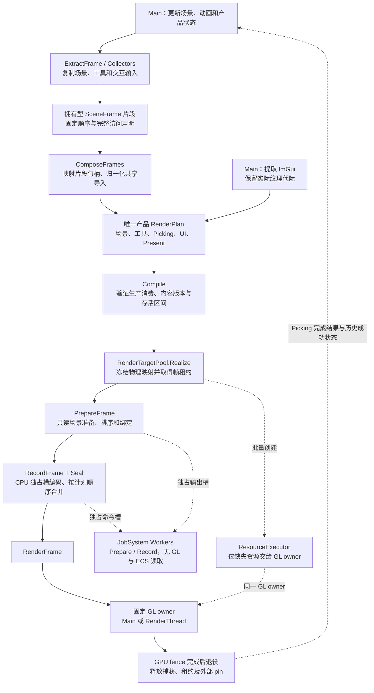
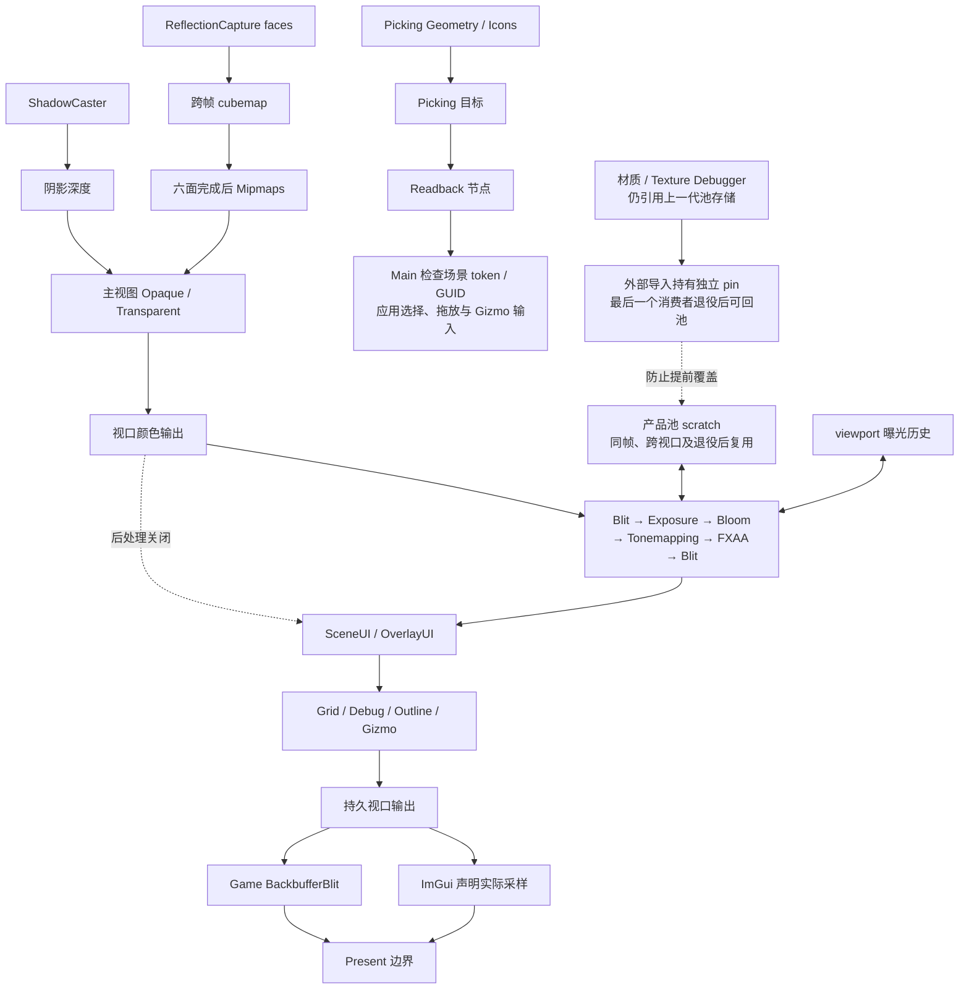
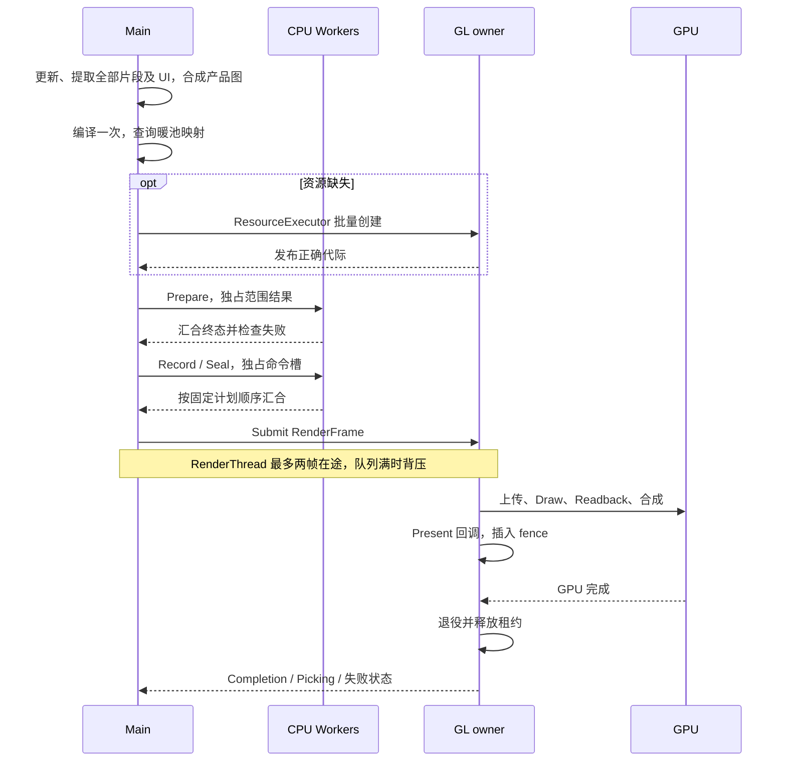

# 当前渲染架构与 FrameGraph 数据流

核对日期：2026-10-06。代码基线：F5 `78c6d9f0` 加 F6 收尾改动。
本图对应当前产品链；历史 A0–A6 记录保留各阶段当时的实现与验收。

## 产品帧的形成

Editor 按 Asset → Game → Scene → Camera Preview → ImGui 保持 GPU 顺序。
Game 按场景 → 后处理/场景 UI → backbuffer blit → 调试 UI → Present 保持顺序。
CPU 任务完成顺序不会改变这些顺序。即时与提交模式都走这一计划，均受资源退役约束。

| 数据 | 范围与所有权 |
|---|---|
| RenderSceneSnapshot | Main 稳定读取期提取场景；保留材质、几何、纹理和程序代际，复制矩阵、灯光与 palette。 |
| SceneFrame | 可作为一个视口片段或组合后的产品准备输入；拥有 Views、RenderPlan、历史登记和准备结果。 |
| RenderPlan | 逻辑资源、描述、子资源访问、Load/Store、内容版本、固定依赖与独立操作节点。 |
| RenderResourceMapping | 编译后冻结的逻辑到物理快照映射；仅完全兼容且存活不重叠的 scratch 可共享。 |
| RenderCommandList | CPU 拥有型操作；上传、绑定、绘制、读回与合成在消费时执行。 |
| RenderFrame | 提交、呈现请求、成功/失败、GPU fence 和退役；持有池租约到 GPU 完成。 |

快照保留存储代际，不自动复制每一次动态 GPU 内容。内容依赖仍由计划和命令顺序保证。

## GPU 资源与消费者

这些操作均在产品图内。后处理没有私有 scratch 缓存或图后的尾插消费者。
曝光、反射历史、视口输出与资产保持持久 owner，不作为瞬态别名目标。
关闭效果停止申请其临时资源；池中闲置缓存按预算淘汰。

## 线程与退役

Main 即时模式同步提交并等待退役；Main 命令模式也由 Main 执行。
RenderThread 模式要求启用帧提交。parallel_recording 在上述有效模式中控制同一
CPU 准备/录制实现；Worker 不访问面板、ECS 或 GL context。

Main 产品池预留一套，RenderThread 预留两套；默认闲置预算 256 MiB。
暖池只做 CPU 查询。尺寸、效果或容量变化可能需要 GL owner 创建资源。
当前图需要的备用目标更新 LRU 使用时间；过量缓存仍可淘汰。
首次出现 ImGui 字形仍需字体纹理上传，不能视为完全无 owner 等待的暖态。
取消、异常和关停不能以 CPU 录制结束代替 GPU 退役。

## 可检查的结果与边界

`CompiledRenderPlan::Dump` 显示节点、访问依赖、版本与逻辑存活区间；
`RenderResourceMapping::Dump` 显示物理槽、纹理及真实别名；池统计显示分配、
命中、淘汰、闲置/租用字节与峰值。实际纹理级别字节不等于全部驱动 VRAM，
Windows Private Bytes 也包含驱动缓存。

当前编译器验证固定顺序，不进行自动裁剪、Pass 重排、多队列同步或 Vulkan barrier
生成。已有 C++ 配置示例在 Tests/RenderingCommands/inspection_pipeline.h；
没有脚本 SRP SDK、流水线编辑器或新增渲染效果。

实现与验证见 [当前架构](RENDERING_ARCHITECTURE.md)、
[FrameGraph F5](FRAMEGRAPH_F5_VALIDATION.zh-CN.md)、
[FrameGraph F6](FRAMEGRAPH_F6_VALIDATION.zh-CN.md) 及
[测试入口](Tests/RenderingCommands/README.md)。
