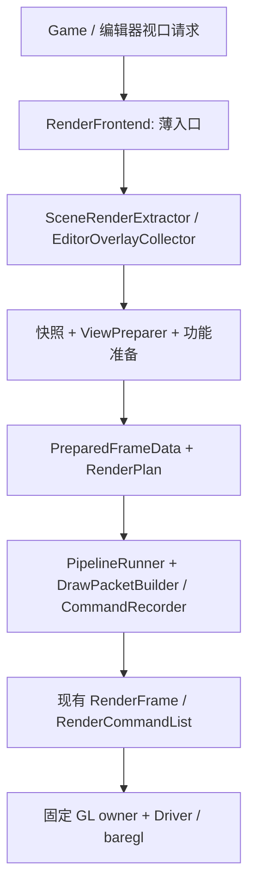
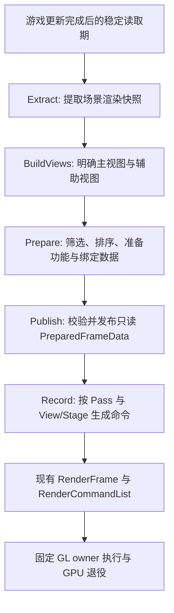
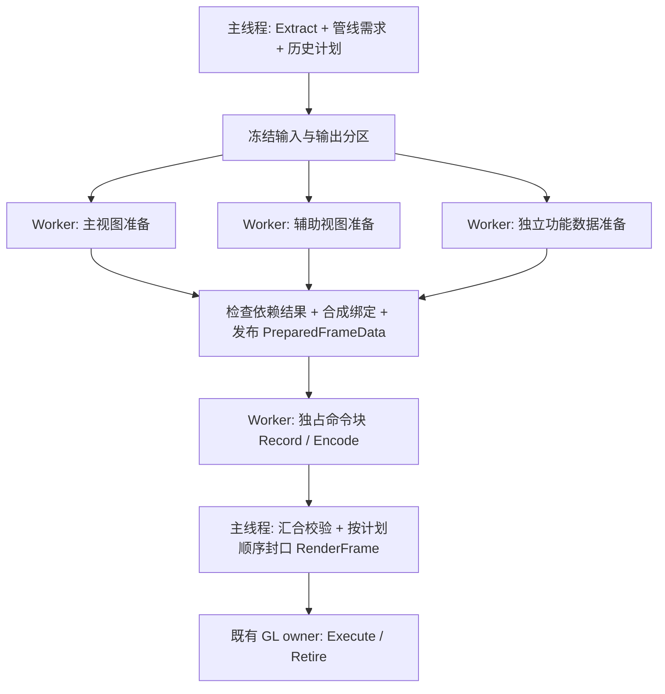

# Overload 多线程渲染架构重构计划

日期：2026-09-09。状态：A0 已完成；A1–A6 未开始。

## 1. 目标与范围

本轮核心是建立清楚、可验证的多线程渲染数据流：游戏状态在哪里提取，哪些准备和录制任务可以独立执行，结果何时发布，以及失败和资源退役由谁负责。Renderer、Pass、Feature 的拆分服务于这些线程边界。

优先级固定为：**多线程的数据所有权与任务依赖 → 渲染职责拆分 → SRP 自定义的扩展边界。** SRP 是兼容要求，不主导本轮的任务模型，也不要求实现完整的脚本渲染管线产品。

此处优先级不是“先给旧 Renderer 加多线程，最后再拆 Renderer”的实施顺序。**Renderer 职责拆分是已经确定的目标结构，也是准备/录制任务独立运行的前提。** A1–A5 逐步将功能接入拆分后的模块；A6 只清理剩余兼容入口并验收，不到 A6 才开始拆分。

**不要求更快，不以 FPS、加速比或任务数量作为验收条件；但实际的并行 Prepare/Record 路径与正确性验证是必交付项。** 先用串行实现建立对照，再由同一批准备/录制函数接入已有 JobSystem。不能以“以后理论上能并行”或“原来的并行编码还能用”作为完成标准。

最初授权为编写计划；2026-09-09 用户已授权按项实施，每项完成后验证并 commit，再开启新会话。本次完成 A0 语义冻结，尚未修改生产代码；下述新类和接口仍是后续实施契约。

建议将本轮安排在现有多线程阶段 4 之后、RHI/Vulkan 之前，使用独立编号 A0–A6。现有阶段 0–4 的完成记录继续有效，本文不重写其历史验收结论。原阶段 5/6 属于后续独立工作。

参考 Destiny 的功能模块、View/Stage 和 Extract/Prepare/Submit 分工；不照搬其全部入口、内存分配方式或平台调度策略。原始资料：[Destiny's Multithreaded Rendering Architecture](https://advances.realtimerendering.com/destiny/gdc_2015/Tatarchuk_GDC_2015__Destiny_Renderer_web.pdf)，重点为第 120–139、168–188 页。下面的名称与迁移步骤是 Overload 的设计建议。

本轮不新增 Vulkan/RHI、GPU Render Graph 自动调度、fiber、GPU 剔除、批处理优化或新的渲染效果；不把当前前向渲染改成延迟渲染，不增加 G-buffer 作为架构前置条件。需要实现的是基于已有 JobSystem 的有限 CPU 任务依赖与汇合，不另写通用调度器；不要求新增游戏第 N+1 帧与渲染准备第 N 帧重叠的产品模式。

本计划统一包含 Pass/Feature、Renderer 继承体系和编辑器视口边界的整理。实施方式是**在当前引擎内重建渲染前端，逐步接管旧入口**：复用 ECS、资源加载、动画、编辑器基础和现有提交后端，不从零重写整个引擎。集中设计能避免分别改造时接口互相冲突，但不把全部迁移合成一次大改。

## 2. 已有基线与要解决的问题

### 保留的基础

- `RenderCommandList`：拥有型命令、延迟编码、确定顺序、失败与历史失效处理。
- `RenderFrame`：帧提交、GPU 完成、资源保留和退役协议。
- `RenderThread` / ResourceExecutor：固定 GL owner、资源操作归属、有界队列和停机顺序。
- 材质、Shader、纹理及几何的快照和代际持有；现有动画评估及发布顺序。
- JobSystem 和已实现的并行编码；默认配置不因架构整理而自动改变。
- 已有 ParseScene/FilterDrawables 分块并行及稳定合并规则；本轮迁移其输入与所有权边界，复用可独立的算法，不把现有并行能力重复列为从零开发。
- 既有真实 GL、图像、产品循环和交互回归。

### 当前结构的问题

| 当前结构 | 要解决的问题 |
| --- | --- |
| `CompositeRenderer::DrawEntity()` 遍历 Feature 钩子 | 数据准备、共享状态修改和命令构造集中在一次 Draw 的调用链中 |
| `SceneRenderer`、阴影和反射各自组织对象处理 | 多视图的可见性、材质阶段选择和提交入口不统一 |
| `FrameDescriptor`、`Drawable`、部分 Descriptor 借用场景对象 | 准备端的数据稳定期依赖调用约定，不能直接作为后续阶段输入 |
| Feature 使用 `unordered_map`，按 Pass C++ 类型筛选 | 执行顺序不明确；阶段含义与具体类绑定 |
| 阴影、反射 Feature 对共享 Material 写单次属性 | 每次绘制的参数没有独立归属，难以直接并行准备 |
| DebugModel/Outline/Gizmo 使用 `NEVER` 但主动绘制 | 自动钩子与主动工具服务混用同一扩展接口 |
| 目标切换、资源生产消费、动态历史依赖隐含在顺序中 | 缺失生产者、错误视图或失效历史不能在统一入口诊断 |

代码依据：`Sources/OvRendering/src/OvRendering/Core/CompositeRenderer.cpp`、`Sources/OvCore/src/OvCore/Rendering/SceneRenderer.cpp`、`ShadowRenderPass.cpp`、`ReflectionRenderPass.cpp` 及对应 Feature 实现。

这些是职责边界问题，不据此声称现有已验收路径存在数据竞争或性能故障。

现有 ParseScene/FilterDrawables 已在受控稳定期内并行，命令编码也已经隔离了一部分不可变输入；准备端仍串行处理 Feature 钩子、材质单次属性和部分历史状态。本轮要将这些局部并行接入统一的快照、视图准备和绘制数据构建契约，并扩大经过验证的独立准备/录制范围。不能直接把现有 `DrawEntity()`、整个 Renderer 或各个 Pass 投入线程池：它们仍共享相机、材质和录制状态。

## 3. 目标职责划分

### 3.1 数据与功能职责

| 概念（拟定名称） | 负责 | 边界 |
| --- | --- | --- |
| SceneRenderExtractor | 在场景读取稳定期提取渲染输入 | ECS/Actor/Component 的读取集中在此及其受控提取回调 |
| RenderSceneSnapshot | 保存本次准备所需的场景渲染值、资源版本、对象身份 | 不携带供后续解引用的 Scene/Actor/Component/Material 借用 |
| RenderView | 相机矩阵、裁剪条件、尺寸、视图身份、支持的 Stage | 主相机、阴影相机、反射面、拾取视图均显式表示；视图本身不决定全部输出目标 |
| RenderStage | 对象参与条件、Shader technique 选择、排序规则 | 一个 View 可以支持多个 Stage；阶段不等于某个 C++ Pass 类型 |
| FeatureProcessor | 某类渲染对象/功能的提取数据格式、准备和命令构造入口 | 只接受阶段允许的数据；不接收可任意访问场景的 Renderer 服务对象 |
| PreparedFrameData | 准备完成的 View、绘制项、绑定数据、功能载荷 | 发布后只读；与现有 `RenderFrame` 的命令提交/退役职责分开 |
| RenderPipeline / Pass | 编排目标、清除、资源生产消费、Stage 提交和后处理 | Pass 不再自行扫描 ECS；功能模块不擅自改变全局输出目标 |
| RenderTaskCoordinator | 从明确的准备需求建立 CPU 任务依赖、提交 Job、汇合状态与发布结果 | 复用 JobSystem；不拥有场景业务、材质策略或 GPU 执行逻辑 |
| CommandRecorder / Executor | 根据显式状态录制；按确定顺序执行 | 复用现有命令与 GL owner，不再在消费端补查游戏状态 |

Stage 首批只覆盖现有需要：Opaque、Transparent、ShadowCaster、ReflectionCapture、SceneUI、Picking。名称在 A0 冻结；与 `.ovfx` 中现有 `SHADOW_PASS`、`REFLECTION_PASS` 等建立显式映射，保留 fallback 和变体语义。渲染 Stage、材质 technique 和 Shader FeatureSet 是三个概念。

后处理等整体操作继续作为 Pass/Effect；无需为了统一命名而制造一个无对象数据的 Stage。场景 UI 与最终 ImGui 合成分别建模，保留其现有执行位置。

FeatureProcessor 不机械地与现有每一个 `ARenderFeature` 一一对应：

- 静态与蒙皮网格先采用统一 MeshFeatureProcessor，内部组合几何、蒙皮和绑定数据提供者，避免为每种能力组合建立子类。
- 引擎常量和灯光整理成按 Frame/View 提供的绑定数据。
- 阴影/反射分成视图与资源计划，以及接收端的绑定数据准备。
- DebugShape/DebugModel/Gizmo/Outline 整理成显式收集器或工具服务；它们可以产生绘制项，必要的 stencil 等步骤仍由专用 Pass 编排。
- 统计使用明确的录制/提交/完成观察接口，不将 GPU 完成解释为 `OnAfterDraw()`。

### 3.2 当前 Renderer 的职责与迁移去向

当前继承链是 `IRenderer → ABaseRenderer → CompositeRenderer → SceneRenderer → DebugSceneRenderer`。它是同一个对象逐层获得能力，并非五个独立渲染器依次处理数据。整理目标是将不同变化方向拆成可组合的职责，不以继承层数或类数量减少作为验收条件。

目标生产结构只有一个统一渲染入口类型，本文暂称 RenderFrontend（最终可命名为 Renderer，二者不是两层入口）。它组合提取、准备、管线、调度和录制模块；各模块继续独立承担职责。一个入口类型不等于全局单例：视图数据、任务输出和历史仍按各自作用域隔离。

旧类名在迁移表中只表示职责来源。迁移完成后删除 IRenderer、ABaseRenderer、CompositeRenderer、SceneRenderer、DebugSceneRenderer 这套旧接口与实现；不保留废弃类、空壳转发、类型别名、Legacy 适配层或旧模式开关。仓库内调用者直接迁移到新入口，不为假设的外部使用者保留旧 API。

| 现有类型 | 当前实际职责 | 目标归属 | 迁移阶段 |
| --- | --- | --- | --- |
| IRenderer | BeginFrame/DrawFrame/EndFrame 的生命周期接口 | 统一前端入口；删除旧接口，显式区分视图准备与产品帧提交，不要求底层模块实现整套生命周期 | A0 定义语义，A6 收敛 |
| ABaseRenderer | 当前相机/目标/viewport、清屏、相机矩阵缓存、材质绑定、几何准备、Blit、命令录制与即时执行 | 相机数据归 ViewPreparer；绑定归 DrawBindings 构建器；目标/清除归 Pipeline；命令归 CommandRecorder；Blit 归显式全屏绘制工具 | A1 建边界，A3/A4 迁移，A5/A6 收尾 |
| CompositeRenderer | Pass/Feature 注册与调度、Descriptor 查询、Feature 钩子、DrawPacket 构建和资源持有 | PipelineRunner 执行 Pass；功能注册与准备交给前端；DrawPacketBuilder 构建完整绘制包；CommandRecorder 管理本次录制 | A2 拆调度，A3 拆绘制包，A6 去旧依赖 |
| SceneRenderer | 安装默认流水线、收集灯光/探针、ParseScene/FilterDrawables、直接绘制模型 | SceneRenderExtractor、ViewPreparer、ScenePipeline 配置、MeshFeatureProcessor；迁移调用者后删除旧类 | A1–A4 |
| DebugSceneRenderer | 通过继承安装编辑器功能和 Pass；配套 Pass 查询组件、选择状态和面板，生成调试绘制 | EditorOverlayCollector 提取数据；EditorOverlay/Picking Pass 绘制；编辑器流水线配置组合这些能力 | A5 迁移，最迟 A6 删除旧类 |

拆分时分别检查几个隐式行为：

- `ABaseRenderer::BeginFrame()` 当前同时进行视图初始化、清除和相机缓存；新入口分别表达纯数据准备与录制目标操作。
- `ABaseRenderer::Blit()` 当前可能 resize 目标、写源材质参数，再虚调用 `DrawEntity()` 进入 Feature 链；全屏绘制工具改为接收显式输入纹理、输出目标、绑定和状态，后处理所需参数不能依赖隐式钩子。
- `CompositeRenderer` 当前同时是流程调度器和可取任意 Descriptor/Feature 的公共服务入口；新 Pass/功能模块只接收所需数据及受限录制接口，不能把旧 Renderer 换名成一个全能 RenderContext。
- `SceneRenderer::BeginFrame()` 包含场景解析/筛选；这部分必须进入可单独调用和验证的 Extract/Prepare 阶段。
- `DrawModelWithSingleMaterial()` 等便捷入口改为产生准备输入/绘制项，统一进入提交链，避免保留一条绕过新数据契约的直接绘制通道。

拆分后的能力通过组合连接：

| 独立职责 | 对外提供的结果 | 与多线程的关系 |
| --- | --- | --- |
| SceneRenderExtractor / EditorOverlayCollector | 场景与编辑器只读输入 | 在主线程稳定期完成提取 |
| ViewPreparer / 功能准备模块 | 可见列表、灯光、蒙皮、绑定等准备结果 | 只读输入、独占输出，按依赖拆成 Worker 任务 |
| RenderPipeline / Pass | View/Stage 需求、资源与绘制步骤 | 决定渲染流程；不管理线程池或共享当前相机 |
| RenderTaskCoordinator | 任务提交、成功检查、汇合与发布 | 管理 CPU 依赖和任务生命周期 |
| DrawPacketBuilder / CommandRecorder | 拥有型绘制包与命令块 | 使用任务局部状态，结果按计划顺序合并 |
| 既有提交与执行后端 | RenderFrame 提交、GPU 执行与退役 | 保持固定 GL owner 和资源生命周期 |

RenderFrontend 只作为应用入口连接这些模块：转交请求、启动受控流程、返回输出/完成凭据。各模块通过显式输入输出连接，不持有可任意调用全部能力的 Renderer 指针。功能模块可以有多个阶段入口，但各阶段数据和可写状态必须分开，不能把共享的“当前 View/Material/CommandList”搬进组件对象。

GameView、SceneView、AssetView 通过请求与管线配置选择能力；编辑器覆盖层由收集器和 Pass 组合加入。MeshFeatureProcessor 这样的名称仅表示网格功能模块，不继承 SceneRenderer，也不实现完整的产品帧生命周期。一个模块可产生多个任务，多个轻量模块也可在同一任务中执行；模块边界和任务粒度分别设计。

### 3.3 编辑器视口与产品入口

当前实际组合如下，A0 以此为核对起点：

| 调用方 | 当前使用的 Renderer / 数据来源 | 整理后的职责 |
| --- | --- | --- |
| 独立 Game | SceneRenderer + 当前游戏场景/主相机 | 提供场景、视图和输出需求，复用统一前端 |
| 编辑器 GameView | SceneRenderer + 当前场景/主相机 | 提供游戏预览视口请求 |
| 编辑器 SceneView | DebugSceneRenderer + 当前场景/编辑器相机 | 提供编辑器显示选项、拾取请求、选择与 Gizmo 输入 |
| 编辑器 AssetView | SceneRenderer + 自建预览 Scene/Actor/模型材质组件，附加网格功能 | 保留预览场景，复用场景提取和流水线配置，不新增专用 AssetRenderer |

`AView` 继续负责面板显示、尺寸、相机控制相关输入以及输出纹理展示；输出表面的创建/resize 生命周期交给明确的视口资源适配器，并沿用 ResourceExecutor 的 owner 约束。面板通过请求表达“本次需要拾取/网格/轮廓”，不再按字符串查找具体 Pass 并改变其内部状态。

编辑器主线程把选中/悬停对象、显示选项和必要的视口信息提取为值或稳定身份；调试准备和绘制阶段不能查询 EditorActions、GameView 面板或遍历 Actor 组件。交互结果仍按现有成功帧与对象身份校验后由主线程应用。

当前 Renderer 的一次 BeginFrame/EndFrame 通常围绕一个编辑器视口，产品 `RenderFrame` 则能聚合多个视口与最终 UI。A0 必须明确命名与作用域，不能把一次 View 完成当作整帧提交或 GPU 完成；统一前端不要求整个应用只有一个带全局可变状态的 Renderer 实例。

### 3.4 目标组合与模块边界

以上是逻辑职责，不要求每个框都变成独立虚接口或公共类。RenderFrontend 只协调输入、准备和录制；它不重新容纳所有实现细节。Pipeline 定义步骤，PipelineRunner 执行步骤；DrawPacketBuilder 将已准备绑定与几何组装为命令载荷，CommandRecorder 管理本次命令输出；这些小职责可以在同一模块内实现。

- `OvRendering` 放通用 View/Stage/准备数据契约、流水线执行和录制基础，不依赖 ECS 或 OvEditor。
- `OvCore::Rendering` 放场景提取、网格/灯光等功能准备和场景流水线配置；ECS 的读取集中于提取入口。
- `OvEditor` 放覆盖层提取、编辑器流水线扩展和视口交互适配；通过通用数据契约连接核心。
- Driver/baregl 负责图形操作，RenderThread 负责消费线程，RenderFrame 负责提交与退役；它们不承担场景提取和功能选择。

录制上下文只拥有一次录制的缓存和当前命令状态；跨帧历史、视口表面和资源版本各有明确 owner。独立场景/视口的曝光、反射、材质覆盖等不能因合并入口而错误共享。注册查找与执行次序分开表达，不再依赖容器遍历顺序。

### 3.5 迁移原则：前端重建，边界接入

新数据链在当前仓库中独立建立，使用目标接口设计；兼容转换集中在场景/面板输入和已有命令后端之间。每个功能切换后明确由新旧哪条路径负责，不能重复制备、绘制或消费历史请求。

不通过持续增加 `if (newMode)` 分支让新架构深入旧继承链。每阶段记录适配器用途和退出阶段，A6 检查所有产品调用点；临时适配器只允许服务于尚未迁移的调用者，最后一个调用者迁移后立即删除，A6 必须清零。分阶段期间可暂留仍承担现有功能的旧代码；不保留无人使用的逻辑，也不新增第二套 GPU 资源管理与提交后端。

### 3.6 SRP 的最小兼容边界

Pipeline 的自定义能力限定在“请求哪些 View/Stage、选择功能、安排 Pass、声明输入输出”。主线程先运行管线构建逻辑，形成准备需求和 RenderPlan；核心据此建立 CPU 任务，功能准备完成后录制命令。管线配置在任务开始前冻结，不能在任务运行中修改注册表或计划。

自定义 Pass 接收声明过的资源、只读准备结果和受限录制上下文。新增准备逻辑必须声明输入、输出和执行归属；未知扩展默认留在受控串行边界，不能因为实现了一个接口就自动在 Worker 执行。以后若加入脚本绑定，脚本是否可并发另行设计。

Stage/technique 和资源列表不能硬编码为“所有不透明物体只能前向着色”或“所有 Pass 只有一个颜色输出”。将来延迟管线可以增加 GBuffer Stage/多附件输出、Lighting Pass，再复用透明前向路径；G-buffer 格式和数据生产消费契约由该管线明确提供，并非仅重排现有 Pass 就自动支持延迟渲染。此处只保留表达能力，不在本轮实现这些效果。

完成标准是一个小型 C++ 管线配置示例能组合现有能力，且不修改任务协调器、场景提取核心或提交后端。流水线编辑器、脚本 SDK、任意第三方插件兼容均不作为本轮交付。

## 4. 数据流与阶段契约

首版允许在 Extract 中复制所有候选渲染对象的数据，再按 View 筛选。无需为减少复制立即实现 Destiny 式可见对象按需提取；正确且清晰的边界优先。

| 阶段 | 可以读 | 可以写 | 必须禁止 |
| --- | --- | --- | --- |
| Extract | 稳定的游戏对象、资产元数据、显式请求 | 本次提取输出；旧单次属性由兼容入口按原时序解析 | 改变动画求值/脚本/场景更新的可观察顺序 |
| BuildViews / Prepare | 只读快照、明确的配置与历史令牌 | 当前 builder 独占的数据、私有中间结果 | 回查 ECS、修改源材质、直接调用 GL |
| Publish | 各阶段结果和状态 | 封口、成功/失败状态 | 任一准备失败后发布半成品 |
| Record | 已发布数据、显式 Pass 状态、已保留资源引用 | 本次命令块、录制局部缓存 | Scene 查询、材质临时写入、依赖当前全局相机/目标 |
| Execute / Retire | 命令拥有的数据及资源 | GPU 状态、完成结果、既有历史/回收协议 | 解引用已离开稳定期的游戏对象 |

`const` 和 `shared_ptr` 不等于内容不可变。帧数据保存数值或不可变版本；资源引用保证存活，动态纹理/缓冲内容仍由有序写入和消费保证正确。同一资源跨帧复用遵守现有队列与历史协议，不以 shared_ptr 替代依赖。

数据按 Frame / View / Object / Draw 分层：例如同一场景快照和姿态版本的骨骼载荷可共享；反射探针选择、物体排序和相机相关结果按其实际依赖保留。不同场景、预览、override、LOD 或版本不能仅凭 Actor 地址合并。

渲染资源的创建/resize 通过既有 owner 服务在受控的资源准备边界完成；Prepare 输出资源需求或使用已经准备好的保留句柄。首版允许同步满足需求，不能把 GL 调用藏回纯数据准备回调。

### 4.1 线程归属与任务划分

| 执行位置 | 本轮职责 | 不承担 |
| --- | --- | --- |
| 主线程稳定读取期 | 更新后的场景/编辑器提取、兼容 singleUse 解析、历史计划与管线构建 | 不把活动 ECS 或可变 Material 交给 Worker |
| 主线程协调入口 | 冻结输入、提交任务、检查汇合结果、确定顺序合并、发布产品帧 | 不通过通用 Renderer 上下文共享可变工作状态 |
| Worker | 视图可见性与列表准备、已发布姿态的渲染数据转换、独立绑定/绘制包构建、独立命令块编码 | 不调用 GL、不访问面板、不改变动画求值或跨帧历史 |
| 既有 GL owner | 资源操作、命令执行、同步和退役；按现有模式为主线程或 RenderThread | 不在执行命令时补查场景 |

首批按独立 View 和绘制列表范围拆任务；只有新快照与独占输出契约已经覆盖的工作才进入 Worker。每个范围内部保持稳定顺序，任务结果按预定位置拼接；不能让多个 Job 同时调用旧 Renderer、向同一个 vector 追加或更新共享绑定缓存。

图中分支仅代表输入彼此独立的任务：例如绑定依赖视图筛选和灯光准备时，必须在两者成功后启动，不能凭“属于不同 Feature”认定可并行。首版允许整批汇合后进入下一阶段，后续再按实际需求细分依赖，不追求最大重叠。

保留现有主线程与渲染线程的队列和重叠模式；本轮首先解决一帧内部的准备/录制并行，不顺带改变游戏更新的帧间流水线、队列深度或默认线程选项。

### 4.2 CPU 依赖与 GPU 顺序分别表达

CPU 任务依赖回答“哪些输入准备成功后，这个任务才能运行”；RenderPlan 回答“GPU 按什么顺序读写目标和资源”。两者有关联，但不能合并成一种完成信号。

例如主视图采样本帧阴影，需要先确定阴影视图和资源计划；主视图与阴影的命令块随后可以独立录制，最终 GPU 必须先执行阴影写入再执行采样。不能因此要求 CPU 等待阴影 GPU 完成后才开始录制主视图。反之，CPU 录制完成也不意味着阴影内容已经可供下一帧历史使用。

### 4.3 所有权、发布与失败

- Extract 输出封口后，生产者也不能继续通过别名修改内容。各阶段 builder 和可写范围只属于一个任务；输出容器预先确定分区，或使用任务私有结果并在汇合后合并。
- 明确区分输入就绪、准备完成、录制完成、帧入队、GPU 完成。采用既有 Job/同步机制建立结果可见性；普通布尔字段和 `const` 不能代替线程同步。CPU 数据一直保留到所有引用它的任务退出；GPU 资源继续按现有退役协议持有。
- 跨帧历史由既有受控 owner 接收成功/失败结果；Worker 只读本帧令牌并产生候选结果。共享缓存首版采用只读版本或任务本地缓存，不先引入复杂并发可变缓存。
- 主线程负责调度和汇合。Worker 不同步调用需要主线程/GL owner 响应的资源服务，不在任务内创建并阻塞等待同池子任务；避免主线程等 Worker、Worker 又等主线程的等待环。
- 前置任务“运行结束”不等于成功。协调器检查显式状态后才启动依赖阶段；出现提交失败、任务失败或取消时，停止发布成功帧并汇合所有已经提交的任务。取消请求不代表任务已退出，不能立刻销毁快照、命令块或保留资源。
- 所有可并行阶段同时保留串行调度方式，两种方式调用同一实现。串行是验证对照和产品可选模式，不保留第二套业务逻辑。

## 5. 必须提前确定的协议

### 5.1 每次绘制的参数

建立独立 DrawBindings/PreparedDrawInput，按所有权区分材质、帧、视图、对象及绘制覆盖参数。Feature 输出自己的类型化数据，由统一绑定构建器合成。不能由多个模块无序写同一个属性。

A0 记录现有实际优先级；A3 再固化冲突规则。语义上由引擎拥有的字段只能有一个写入者；扩展槽冲突明确报错或要求显式顺序。保留用户材质参数、override/fallback 材质、Shader 变体选择和单次属性语义。

对外部 `SetProperty(..., singleUse=true)`，在兼容入口按旧顺序解析成独立覆盖值，保留既有消费及失败前缀行为；不要默默改成“整帧只消费一次”，也不要承诺通用事务回滚。迁移后的内置阴影/反射功能不再通过修改源 Material 注入参数。

### 5.2 Pass 与资源依赖

采用小型显式 RenderPlan：固定有序 Pass 列表，加每个 Pass 的 View/Stage 引用、目标配置、读写资源和有效性要求。不实现自动重排、资源别名、通用 barrier 推导或瞬时资源分配器。

资源使用需区分：当前帧生产、显式导入、有效历史。描述包含逻辑身份/代际以及必要的 cubemap 面或子资源信息。校验缺失生产者、错误 View/Stage、输出尺寸、非法当前附件反馈和失效历史。

禁用阴影生成时，接收端必须采用明确的无阴影结果或有效导入资源；没有可用反射时采用既有 fallback。不能因为资源对象仍存活就视为内容有效。A0 将现有定义良好的行为与需要补充定义的无效组合分别记录；修正已有缺陷作为独立变更，不混进等价性重构。

反射渐进捕获、曝光等跨帧状态有独立 owner；帧内只持有计划结果/历史令牌。请求消耗、Cubemap 发布和失效重建继续遵守既有协议，不提前将“准备完成”当作“GPU 写入完成”。

### 5.3 排序、身份与失败

- 原有透明排序、材质分组和等值 key 顺序保持不变。显式保留原收集序号，不能改为指针地址或任务完成顺序。
- ViewID、对象身份、场景代次用于匹配帧内输入和异步结果；拾取结果仅在现有成功且仍适用的主线程边界解析。
- 每个阶段有完成状态和有效结果；Wait 返回不代表成功，任一失败需按现有规则汇合、取消/失效和释放。
- 现有派生 Feature、自定义 Mesh 等逐项迁移到新契约；不支持的扩展明确拒绝，不能静默回退旧链路或自动授予新数据/录制契约。

## 6. 分阶段实施

依赖顺序：A0 → A1 → A2 → A3 → A4 → A5 → A6。每阶段独立验收，提交粒度可再拆小；不同时重写上层功能和底层 GL 后端。

### A0：冻结语义与迁移清单

状态：已完成（2026-09-09）。交付见 [A0 基线与迁移契约](RENDERING_ARCHITECTURE_A0_BASELINE.md)，包含固定提交、调用图、方法/状态归属、功能清单、Stage 映射、参数规则、JobSystem 语义、验证矩阵及 A1 交接。本阶段仅文档与源码核对，未新增并发路径，未运行构建或产品测试。

交付：当前调用图、Renderer 方法/成员归属表、全部 Pass/Feature/主动工具清单、Stage 与 technique 映射、参数所有权表、兼容性矩阵。覆盖 Game、Scene/Game/Asset View、SceneUI 和最终 ImGui；按第 3.2–3.4 节明确每个旧入口的接管模块、生命周期作用域和退出阶段。

多线程交付：逐项标出当前主线程、Worker、GL owner 的读写状态和等待关系；列出每个拟迁移任务的输入、唯一输出 owner、前置条件、发布点及失败收尾。确认现有 JobSystem 的完成/异常语义和适用提交入口，不假定依赖 Job 会自动跳过失败结果。

冻结一个可复现的新架构对照基线，记录提交及必要的工作区差异；不修改历史测试的固定基准。新旧路径应能独立重置并复放相同输入，避免同时执行导致单次属性、反射捕获或曝光状态被消费两次。

验收：每个现有功能都有目标归属、迁移阶段和验证入口；明确允许改变的无效状态诊断。此阶段不改渲染行为。

### A1：建立快照与任务边界，贯通最小路径

交付：薄 RenderFrontend 入口、提取适配器、最小 ViewPreparer、RenderSceneSnapshot、RenderView、PreparedFrameData 的可写 builder/只读发布边界，以及临时旧路径适配器。静态路径从 SceneRenderer 的隐式 BeginFrame 准备中分离，以有限输出接口接入现有命令后端；尚未迁移的职责仍明确留在旧入口。

先接通主相机静态不透明物体：Extract → Prepare → Record → 现有命令执行。其余功能继续走旧路径；明确两条路径覆盖的对象集合，避免重复绘制。先串行建立对照，再将同一个纯数据 Prepare 函数放到已有 Worker 上执行并汇合；A1 结束前验证线程边界，不能只交付类的拆分。

迁移位置：SceneRenderer、FrameDescriptor/Drawable 的生产入口。旧 Drawable 可保留在兼容入口，但不得直接成为新 Prepare/Record 的场景借用载荷。

验收：提取后修改或销毁源对象，新路径仍使用原快照；无当前 GL 上下文也能进行纯数据准备；串行/Worker 路径与对照图像、绘制顺序及参数一致。失败输入不可发布，任务退出前输入不会释放。此时不要求多个准备任务彼此重叠。

### A2：统一 View/Stage 列表，接通并行准备

交付：Stage 描述及 technique 映射、按 View/Stage 分组的绘制列表、显式排序规则、MeshFeatureProcessor 的静态网格入口。ScenePipeline 配置与 PipelineRunner 从 CompositeRenderer/SceneRenderer 的混合职责中拆出；首版可执行简单固定步骤，A4 再补齐辅助视图与资源校验。

迁移 Opaque、Transparent、SceneUI。Pass 只设置阶段上下文并调用统一提交入口，不再直接解释场景 Descriptor；按类型判断 Feature 黑白名单的功能逐项转换为 Stage 能力或绑定需求。

多线程交付：最小 RenderTaskCoordinator 使用现有 JobSystem，支持独立 View 或候选范围的并行筛选/列表准备、显式成功检查和确定顺序合并。先对已经迁移的静态网格路径启用；两个任务读取同一不可变快照，但不共享可变列表。透明排序在候选汇合后按完整列表执行，不能拼接局部排序结果冒充全局排序。

验收：同一对象参加多个 Stage 的列表正确；透明、等值 key、材质覆盖/回退、实例和缺失 technique 行为与基线一致。Stage 不支持时明确跳过/拒绝，不能任意选择默认 shader。可控测试证明至少两个独立准备任务实际进入执行，改变完成顺序不改变输出；某分支失败后不得发布部分列表。

### A3：隔离功能数据，接通并行绑定与录制

交付：Frame/View/Draw 绑定数据、蒙皮准备、灯光准备、独立材质覆盖载荷。将 EngineBuffer、Lighting、Skinning 从隐式钩子迁移到明确准备入口；补齐阴影/反射接收参数的数据结构，生产端在 A4 接通。DrawPacketBuilder 和录制局部缓存脱离 CompositeRenderer 的全局钩子调度，ABaseRenderer 的材质绑定职责由显式输入接管。

动画评估和 pose 发布仍在现有更新边界；本阶段只迁移渲染输入，不移动脚本可观察的动画逻辑。Record 只消费发布数据，缓存局限于显式录制上下文。

多线程交付：按真实依赖调度功能数据与绘制绑定构建；在准备结果封口后，为独立绘制范围分配私有命令块/录制上下文，并接入既有拥有型命令与编码后端。首版可串行产生目标切换等控制命令，再按预定槽位汇合绘制块。块入口显式提供必要状态，不能依赖另一个任务最后绑定的材质或相机。

已有 `RenderCommandList` 并行编码入口存在主线程调度及粒度条件。不能直接从 Worker 嵌套调用其调度入口；协调器统一拥有任务提交，按需抽出可复用的纯编码函数。复用命令格式、确定顺序与失败协议，不建立两层相互等待的调度链。

验收：共享材质的多个物体/视图互不污染；蒙皮在主画面及现有辅助路径行为一致；单次属性消费/失败语义、骨骼 identity、材质版本保持原契约。新路径没有逐 Draw 的源 Material 写入。并行绑定和命令块录制使用独占输出，乱序完成、失败分支和串行对照通过；Worker 无 GL 调用。

### A4：迁移辅助 View 与显式 RenderPlan

交付：ShadowCaster、ReflectionCapture View/Stage；阴影、反射的资源与历史计划；Pass 输入输出校验。主相机数据无需通过全局 `SetCamera()` 切走再恢复来维持新路径正确性。

去除阴影 Pass 的 ECS 扫描、反射 Pass 的隐式场景读取，改由快照和统一 View 准备输出驱动。ABaseRenderer 中相机初始化的含义移入 ViewPreparer，目标/清除的选择由 RenderPlan 明确表达并交给录制接口。保持现有阴影支持范围、探针影响规则、逐面捕获策略和目标切换语义。

多线程交付：主视图、阴影、计划中本帧需要捕获的反射面使用相同的准备任务契约；将可以独立工作的分支接入协调器。CPU 汇合和 GPU Pass 顺序分别表达；历史提交仍经过既有 owner。不得为了增加任务数而改变原本逐面捕获的产品行为。

验收：主视图/阴影/反射相机、目标、附件面隔离；缺失/禁用生产者处理明确；实际动态图像、渐进反射、取消/失败后历史重建和跨帧复用通过。资源存活与内容有效性分别验证。

### A5：迁移编辑器工具、拾取和后处理

交付：显式 Debug/Overlay 收集器，Outline/Gizmo 的数据与 Pass 步骤；Picking View/Stage 和拥有型结果；后处理设置快照及独立历史状态入口。

AssetView 当前使用自建预览 Scene 与 ECS 组件，继续复用场景提取入口；不预设它需要单独的非 ECS 适配器。AView/SceneView 改为提供显式视口与拾取请求，DebugSceneRenderer 的配置职责移入编辑器流水线配置，随后删除旧类，调试组件查询移至 EditorOverlayCollector。SceneUI 走自身 Stage；最终 ImGui 继续使用已有拥有型 UI 快照和后端，不强行变成 MeshFeatureProcessor。后处理继续使用现有 Effect 和 ping-pong 资源，但 Record 不再读取 CPostProcessStack；Blit 改为显式输入输出和绑定，脱离隐式 Feature 链。

多线程交付：三视口使用独立帧内上下文，由产品帧统一汇合；窗口 resize、场景切换、删除对象、播放切换时，在途任务仍持有自己的输入。轻量后处理编排或编辑器收集可留在主线程，但其归属和依赖必须显式；不要求每个 Pass 都变成一个 Job。

验收：三视图、网格/轮廓/Gizmo/调试对象、实际拾取/材质拖放、完整 UI 合成、窗口 resize/最小化、场景切换和播放模式正确。删除目标后不应用旧帧交互；后处理和曝光历史行为不变。

### A6：完成并发验收，删除旧链路并验证管线扩展

交付：迁移后的唯一生产数据准备路径；明确的模块依赖、扩展示例和错误信息；更新架构文档与旧路线的后续入口。

按第 3.2 节逐项核对 Renderer 方法与状态归属；所有产品调用者使用唯一新入口，通过管线配置组合功能。删除旧 Renderer 继承链、无人使用的成员/工具、旧注册入口及构建引用。清理 AView 对内部 Pass 名称和可变 Feature 的控制，以及旧直接模型绘制/Blit 旁路。

移除内置渲染链对 `ARenderFeature::OnBeforeDraw/OnAfterDraw`、按 Pass RTTI 筛选、借用型场景 Descriptor 及可变全局相机的依赖。迁移全部现有使用者后直接删除旧接口、旧钩子基类及相关实现，不留下 deprecated 标记、Legacy 层、转发壳或禁用代码。

迁移期间旧路径作 oracle；收尾后仅通过历史 Git 提交、对照图像和记录保留基线，当前源码与测试目标不再内嵌第二套旧实现。仍有价值的行为测试迁移到新入口。现有同线程/Render 线程执行选项继续保留；它们共享新准备结果，不各自维护一套功能逻辑。即时执行模式若继续作为产品选项，也应消费同一份显式准备结果；旧钩子实现随旧链路删除，不借测试或配置开关保留。

完成实际多 Worker Prepare/Record 与现有渲染线程执行组合的整体验证；串行和并行共享输入契约、功能实现、确定顺序及失败规则。逐项检查残留串行步骤是明确的 owner/依赖选择，还是仍被旧共享状态迫使串行，后一类必须处理或列为未完成项。

最后补充第 3.6 节的最小管线配置示例，证明现有 Pass/功能可以组合，而无须改动调度和后端。此示例服务于扩展边界验收，不把本阶段扩成完整 SRP 开发。未完成全功能迁移和多线程验证时不能只因静态串行场景通过就关闭本轮。

## 7. 架构验收标准

全部满足才算完成：

1. Prepare/Record 的接口和实际调用链不访问 Scene/Actor/Component，也不借用可变源 Material；提取层是游戏状态的集中入口。
2. Published 数据在类型/所有权上不可继续修改，输出失败不会以成功帧被消费。
3. 主视图、阴影、反射、拾取都具有显式 View/Stage；同一网格的阶段变化无需复制 ECS 遍历或对象绘制代码。
4. Pass 的输出目标及必要资源依赖可在 RenderPlan 中读出，功能模块只处理本地数据和显式参数。
5. 每个绑定字段、临时缓存、动态历史都有唯一明确的 owner；不存在无序 Feature 写同一参数的隐藏契约。
6. 完成新功能不需要修改统一 DrawEntity 去添加类型分支；内部扩展示例能展示注册、准备数据、选择阶段、产生绘制项的完整流程。
7. 现有前向着色、排序、蒙皮、辅助视图、后处理、UI、交互和生命周期回归通过；行为变化单独列明原因与证据。
8. 实际多 Worker Prepare/Record 通过并发验证；串行执行调用同一实现。不新增必须开启的线程选项，不用性能提升或任务数作为通过条件。
9. Renderer 职责映射逐项闭合：场景提取、视图准备、流水线编排、绘制包构建和执行后端可分别解释其输入输出，未通过更名复制原有混合职责。
10. 产品面板只提供请求和接收输出，不操作内部命名 Pass；调试绘制不回查编辑器面板或 ECS。单个 View 的生命周期与产品 RenderFrame 的提交/完成明确区分。
11. CPU 任务依赖、GPU 资源顺序和跨帧历史完成分开表达；任务结束不冒充成功，录制完成不冒充 GPU 完成。
12. 任务输出独占，结果可见性由同步保证；失败/取消/停机时已提交任务全部汇合，输入和资源不会提前释放。无 Worker 与主线程/GL owner 的循环等待。
13. 小型自定义管线通过明确需求、Pass 和资源契约组合既有功能，不修改任务协调器或后端，也不绕过只读输入与线程归属规则。
14. 仅有一种统一渲染入口类型；旧 Renderer 继承链、旧 Feature 钩子系统、临时旧接口适配器、旧模式开关和无人使用的构建引用全部删除。功能模块采用 Processor/Preparer/Collector 等职责命名，不形成新的 Renderer 继承体系。

“源销毁后回放成功”只能证明所有权的一部分，还需检查快照内容、资源代际及动态 GPU 内容依赖；“图像一致”也不能替代接口与状态边界检查。

## 8. 验证策略与已有入口

A0 仅文档与源码核对，不执行构建或产品测试。A1 起按下面的要求验证实际实现。

每个增量只运行受影响的真实行为回归及必要的边界测试；模块布局/头文件变化后完整构建 Debug/Release。A6 再做整体验收，不在每个文档或命名变化后重复全套压力和性能采集。

| 变化 | 优先复用的测试 |
| --- | --- |
| 帧/物体/材质快照 | `snapshot_validation.cpp`、`draw_input_validation.cpp`、`frame_input_validation.cpp`、`packet_validation.cpp` |
| 参数覆盖与 singleUse | `material_validation.cpp`、`parallel_recording_validation.cpp` |
| View/Stage、目标和历史 | `target_state_validation.cpp`、`command_list_validation.cpp`、真实 SceneRenderer 图像用例 |
| 提交与资源生命周期 | `render_frame_validation.cpp`、`resource_lifetime_validation.cpp`、`resource_executor_validation.cpp` |
| 编辑器与产品行为 | `editor_command_validation.inl`、`editor_frame_validation.inl`、`editor_thread_validation.cpp`、`editor_stress_validation.cpp`、`game_thread_validation.cpp` |

源码位于 `Tests/RenderingCommands/`；运行参数及组合限制以其 README 和 `Tests/Skinning/run-validation.mjs` 为准。历史独立链接测试需要匹配的头文件/对象布局，不为让旧基线编译通过而改写其行为。

新增测试聚焦新契约：提取后源变更/销毁、只读发布与失败、Stage/technique 映射、排序稳定、绑定冲突、辅助视图参数隔离、缺失资源生产者与有效历史。避免只验证构造函数/字段 getter 或复制实现逻辑的测试。

并发验证增加以下行为检查，优先扩展已有并行录制和产品测试入口：

- 串行、单 Worker、多 Worker 调度同一输入，得到相同语义的准备数据、绘制顺序和图像；配置组合遵守现有执行模式限制。
- 用有超时的任务闩锁/事件控制顺序，证明多个独立任务确实在不同 Worker 上执行；主动反转完成次序检查确定性。测试规模与配置明确触发并行分支，不能因为生产阈值回退串行却宣称测过并行。
- 注入准备失败、编码失败、部分提交失败和取消；检查全部已提交任务退出后才释放输入，未发布半成品、未挂起依赖任务、未误提交历史。
- 在实际产品循环中覆盖三视口、共享材质、蒙皮、阴影/反射，以及任务在途时的 resize、场景切换和停机。
- 用线程身份断言与针对性的执行记录核对 owner；图像对比、生命周期检查和并发顺序检查互相补充，不把任一种单测当作全部无竞争的证明。

Renderer/面板边界通过调用关系审查和真实集成行为验证：无面板依赖地处理已经提取的覆盖层数据；同一请求序列驱动不同视口配置；不在新旧路径重复提交绘制或消耗 singleUse/历史；Blit 不污染后续材质/相机/目标。无需专门编写只检查类名或继承层数的测试。

新旧路径使用同一确定性输入序列，时间、随机值及历史状态分别重置。可确定用例要求图像和逻辑绘制序列一致；若存在既有非确定因素，先隔离并记录依据，不通过随意放宽像素容差掩盖差异。全部等价检查允许合法的内部命令表示变化，以外部结果和必要顺序为准。

不要求新增微基准、加速比或 Tracy 性能门槛；必要的任务执行记录用于证明线程归属、实际并发与汇合关系。若出现卡死、无界增长或不可用的交互退化，作为正确性/可用性问题修复，不扩展为本轮优化项目。

## 9. 首个实施切片与退出方式

A0 已单独完成。下一次实现任务只承接 **A1 的主相机静态不透明切片**：

- 使用 [A0 固定基线和归属表](RENDERING_ARCHITECTURE_A0_BASELINE.md)，落地最小快照/视图/准备输出。
- 一个标准静态网格和材质经新数据链进入已有命令提交。
- 先串行对照，再把同一个 Prepare 函数交给现有 Worker 执行；证明提取后源对象变化不影响结果，准备阶段不依赖 GL，上下文状态显式，失败能正确汇合。
- 保留完整旧路径对照；不同时迁移阴影、反射、后处理或调度器。

每个阶段通过前保持可切回上一已验收入口；包含动态历史的切换在帧外进行并按现有规则排空/失效。迁移适配器必须记录所服务的调用点及移除阶段，不能成为永久的隐藏数据通道。

完成记录应分别列出“数据与线程归属”“实际任务依赖和并发验证”“职责迁移完成”“行为验证通过”“尚留适配器”，不以阶段名称、类数量或文件创建数量代替交付结果。

## 10. 相关项目文档

- [现有多线程路线与约束](MULTITHREADING_NEXT_STEPS.md)
- [阶段 4 最终验收](MULTITHREADING_PARALLEL_RECORDING_VALIDATION.md)
- [阶段 2/3 完成记录](MULTITHREADING_STAGE23_COMPLETION.md)
- [命令与产品回归入口](Tests/RenderingCommands/README.md)

当前已完成 A0，交付 [语义基线与迁移契约](RENDERING_ARCHITECTURE_A0_BASELINE.md)；A1–A6 未开始。后续每个增量补充结果与剩余工作，完成一项后独立 commit，并结束当前会话提示用户开启新会话。
